# sravioli/wezterm

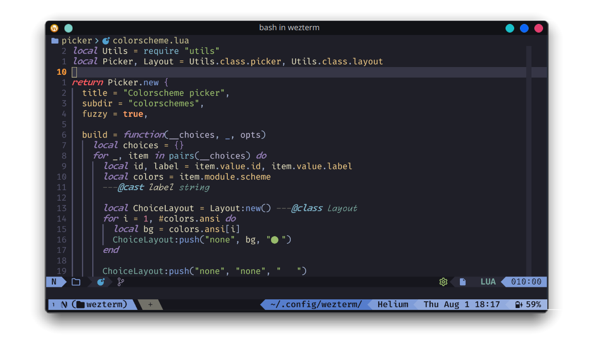

A modular [WezTerm](https://wezfurlong.org/wezterm/) configuration written in
Lua. It includes a responsive status bar, Vim-style modal keybindings,
interactive pickers, and an override system for local changes.

## Installation

> [!NOTE]
>
> **Requirements:**
>
> - [WezTerm **nightly**](https://wezfurlong.org/wezterm/installation.html)
> - [Fira Code NerdFont](https://www.nerdfonts.com)
> - [Monaspace Radon](https://github.com/githubnext/monaspace/releases/latest),
>   [Monaspace Argon](https://github.com/githubnext/monaspace/releases/latest),
>   and [Monaspace Krypton](https://github.com/githubnext/monaspace/releases/latest)

1. **Backup any old config:**

    ~~~sh
    # Linux / macOS
    mv ~/.config/wezterm ~/.config/wezterm.bak
    ~~~

    ~~~powershell
    # Windows (PowerShell)
    Move-Item $env:USERPROFILE/.config/wezterm $env:USERPROFILE/.config/wezterm.bak
    ~~~

2. **Clone the repo:**

    ~~~sh
    # Linux / macOS
    git clone https://github.com/sravioli/wezterm.git ~/.config/wezterm
    ~~~

    ~~~powershell
    # Windows (PowerShell)
    git clone https://github.com/sravioli/wezterm.git "$env:USERPROFILE/.config/wezterm"
    ~~~

3. **Launch WezTerm** and press `Ctrl+Space` then `h` to enter **Help Mode** -
   you'll see all available keybindings at a glance.

> [!TIP]
>
> See the [Platform Setup](https://github.com/sravioli/wezterm/wiki/Platform-Setup)
> wiki page for WSL, SSH, and GPU configuration details.

## Features

### Responsive status bar

https://github.com/user-attachments/assets/d8bd96f1-53d6-4fb0-9771-53ca8ecd604b

The status bar adapts to the available terminal width. Each element has
fallback modes, from full detail down to icon-only, so important information can
stay visible in narrower windows.

> [!NOTE]
>
> Compare to the stock WezTerm status bar:
>
> 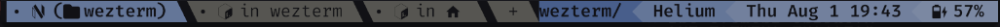

### Modal modes with guided prompts

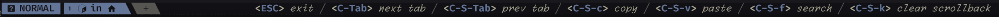

Six modal tables provide inline key hints through
[chord.wz](https://github.com/sravioli/chord.wz). The leader key is
`<C-Space>`. Use `<leader><Space>` for the command picker and `<leader>?` for
the searchable key help overlay.

| Leader combo | Mode | Description |
|-------------|------|-------------|
| `<leader>h` | Help | Reference overlay of all bindings |
| `<leader>w` | Window | Pane splits, navigation, resize |
| `<leader>f` | Font | Adjust font size interactively |
| `<leader>c` | Copy | Vim-style text selection |
| `<leader>s` | Search | Pattern matching and navigation |
| `<leader>p` | [Lantern](https://github.com/sravioli/lantern.wz) | Pickers for theme, font, GPU, window, cursor, and tab styling |

Prompts are responsive - they paginate when the terminal is narrow.

<details>
<summary>See all mode screenshots</summary>

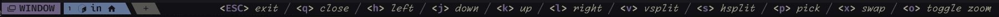
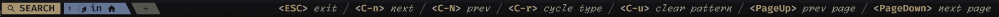
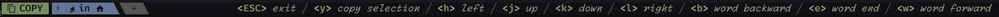
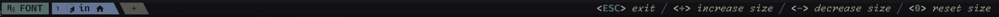
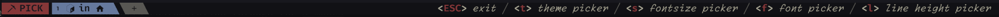
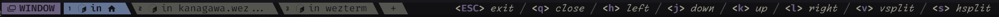

</details>

### Interactive pickers

Built-in pickers wrap WezTerm's `InputSelector` through
[lantern.wz](https://github.com/sravioli/lantern.wz):

1. **Colorscheme** - nearly 30 themes with inline palette preview
2. **Font** - 19 NerdFont families
3. **Font size** - Preset sizes
4. **Font leading** - Line spacing presets
5. **GPU** - Adapter selection from `wezterm.gui.enumerate_gpus()`
6. **Window opacity** - Background opacity presets
7. **Window padding** - Compact through wide padding presets
8. **Cursor style** - Steady and blinking cursor shapes
9. **Inactive pane opacity** - Inactive pane dimming presets
10. **Font ligatures** - Standard, discretionary, or disabled ligatures
11. **Tab bar style** - Native, retro, or powerline tab styling

Startup uses WezTerm's automatic GPU selection unless Lantern restores a
saved selection. Adapter discovery runs when the GPU picker opens, not while
loading the base config. Legacy vendor-only selections require one discovery
pass to migrate to an adapter descriptor.
To keep an explicit adapter, select it in the GPU picker or set
`webgpu_preferred_adapter` in `overrides.config`.

<details>
<summary>See picker screenshots</summary>

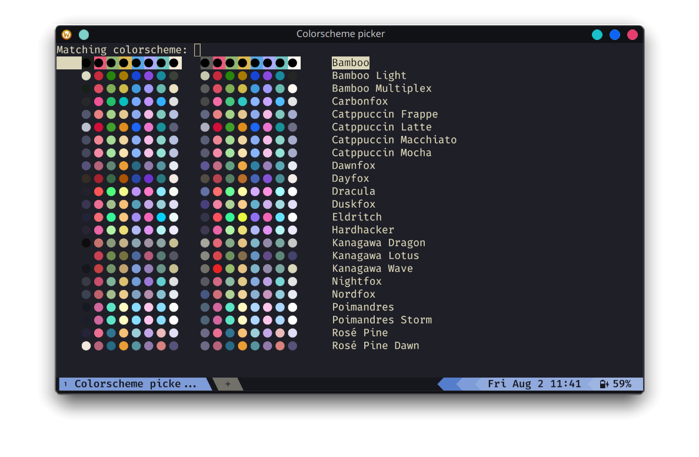
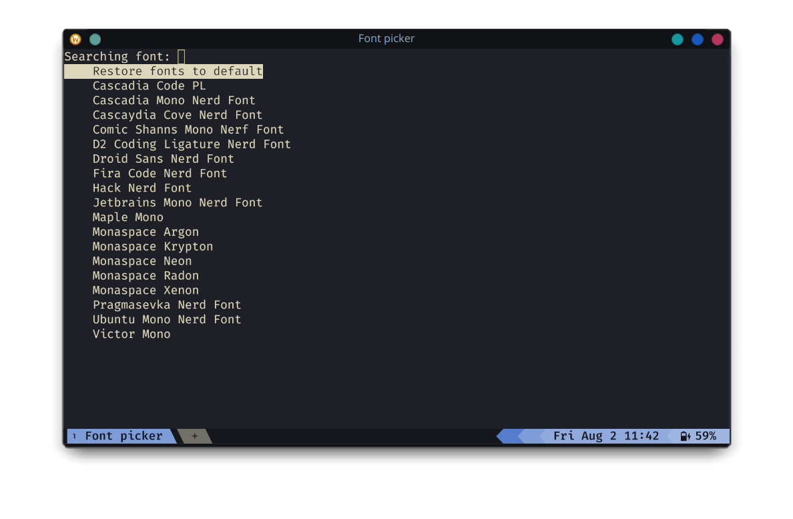
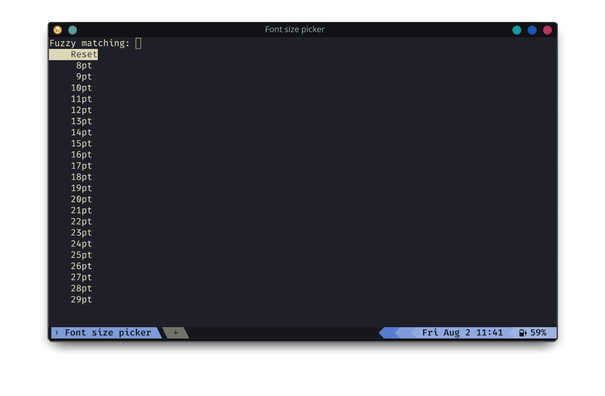
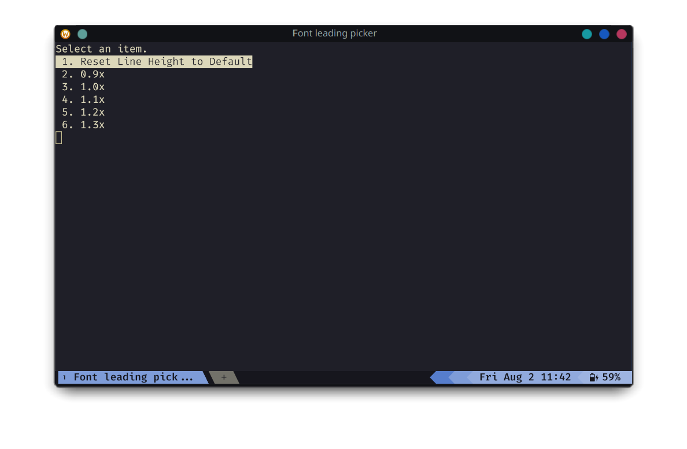

</details>

### Vim-style keybindings

More than 50 keybindings use Vim notation and
[chord.wz](https://github.com/sravioli/chord.wz) translates them to WezTerm's
native format.
Global bindings live in `mappings/default.lua`; modal tables live in
`mappings/modes.lua`.

```lua
-- Vim syntax is automatically translated:
"<C-S-a>"     -->  { key = "a", mods = "CTRL|SHIFT" }
"<leader>w"   -->  { key = "w", mods = "LEADER" }
"<M-CR>"      -->  { key = "Enter", mods = "ALT" }
```

## Learn more

| Page | Description |
|------|-------------|
| **[Keybindings](https://github.com/sravioli/wezterm/wiki/Keybindings)** | All modal tables and default keymaps |
| **[Architecture](https://github.com/sravioli/wezterm/wiki/Architecture)** | Project structure, load order, design patterns |
| **[Customization](https://github.com/sravioli/wezterm/wiki/Customization)** | Override system, custom pickers, themes, keybindings |
| **[Recipes](https://github.com/sravioli/wezterm/wiki/Recipes)** | Practical examples and tips |
| **[Troubleshooting](https://github.com/sravioli/wezterm/wiki/Troubleshooting)** | FAQ and common issues |
| **[Platform Setup](https://github.com/sravioli/wezterm/wiki/Platform-Setup)** | Windows, Linux, macOS specifics |
| **[Contributing](https://github.com/sravioli/wezterm/wiki/Contributing)** | How to contribute |

### Harbor picker status hints

The Harbor picker uses the short, left-aligned `Search: ` input and opts into
`picker.hint_position = "status"`. `chord.use_harbor_status_hints()` installs the
optional adapter before `harbor.apply_to_config(config)`; the status renderer
uses Chord's temporary per-window bindings and normal width budget.
`Ctrl+Shift+Alt+Left`/`Right` page the hints. Closing the picker restores
ordinary modal/status content. The adapter does not enable the bar or alter its
layout: hints require `opts.statusbar.enabled` and a visible tab/status bar
with room for the `keys` module.

Standalone Harbor defaults to `"top"`; use `"none"` or `picker.hints = false`
to suppress generated hints. Explicit descriptions remain separate from
search input, and native InputSelector replaces its description row while
filtering. See each plugin README for adapter setup and limitations. Lantern's
preview prototype is unchanged.

## License

- **Code** in this repository is licensed under [GNU GPL v2.0](../LICENSE).
- **Documentation and other non-code assets** are licensed under [CC BY-NC 4.0](../LICENSE-DOCS).

## Thanks

- [@Wez](https://www.github.com/wez) for the awesome terminal.
- [@aperezdc](https://github.com/aperezdc/) for [lua-wcwidth](https://github.com/aperezdc/lua-wcwidth).
- [@KevinSilvester](https://github.com/KevinSilvester) for the GPU adapter auto picker.
- [@twilsoft](https://github.com/twilsoft) for inspiring the modal prompts with [wezmode](https://github.com/twilsoft/wezmode).
- [@akthe-at](https://github.com/akthe-at) for contributions to the project.
